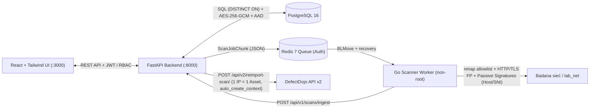
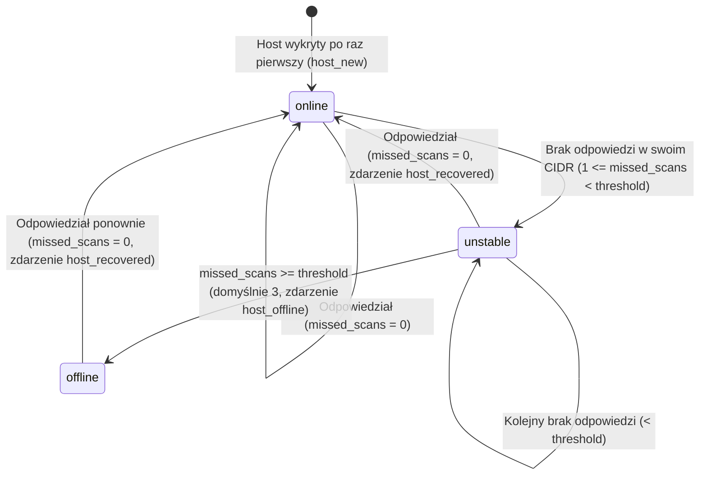

# Architektura Systemu: Janus ASI (Attack Surface Intelligence — CBI AGH)

Dokument opisuje architekturę techniczną prototypu **Janus ASI (Attack Surface Intelligence)** — inteligentnego orkiestratora skanowania powierzchni ataku i pomostu integracyjnego do **DefectDojo (API v2)**.

---

## 1. Architektura wysokiego poziomu (Pomost do DefectDojo)

System nie duplikuje funkcji zarządzania podatnościami z DefectDojo. Zamiast tego rozwiązuje problemy, których DefectDojo nie obsługuje natywnie: bezpieczne skanowanie dużych sieci (`>10 000 IP`), dzielenie zakresów na paczki, pilnowanie okien czasowych, odfiltrowywanie szumu i niestabilnych hostów oraz wzbogacanie znalezisk o bezpieczne sygnatury pasywne i ręczny kontekst analityków (`asset_overrides`).



---

## 2. Adaptacyjny podział dużych sieci CIDR (Chunker) i Okna Czasowe (Pause & Resume)

### 2.1. Dzielenie zakresów `>10 000 IP`
Moduł [chunker.py](../backend/app/services/chunker.py) przyjmuje pojedyncze IP, domeny oraz duże sieci CIDR (np. `/16` = 65 536 adresów IP lub `/22` = 1024 adresy IP), **scala nakładające się zakresy (`collapse_addresses`)** i dzieli je statycznie lub **adaptacyjnie (`adaptive_chunking=true`)** na podgrupy `/24–/28` wyznaczone na podstawie zmierzonej historii szybkości skanowania (`measured_ips_per_sec`) oraz długości okna + zwraca szacowany czas trwania (`estimated_duration_seconds`).
- Wszystkie cele przechodzą filtr bezpieczeństwa SSRF (blokada loopback `127.0.0.0/8`, metadata `169.254.0.0/16`, kontenerów `postgres`/`redis`/`backend`), a flagi `nmap` podlegają ścisłej białej liście po stronie backendu i skanera Go.
- Każda paczka jest zapisywana jako osobny rekord w tabeli `scan_chunks` powiązany z `scan_runs` i pobierana przez worker Go niezawodnym poleceniem Redis `BLMove` (z automatycznym odzyskiwaniem paczek po awarii workera).
- Wygasłe przebiegi są automatycznie uzgadniane (`reconcile_stale_scan_runs`) do `paused_window` (dostępne jest też ręczne `POST /api/v1/scans/{id}/cancel` i `POST /api/v1/scans/reprobe-unstable`).

### 2.2. Rygorystyczne pilnowanie okien czasowych
W dużych sieciach uczelnianych i korporacyjnych skanowanie może odbywać się wyłącznie w wyznaczonych oknach serwisowych (np. `22:00–06:00`):
1. **Weryfikacja w workerze Go ([main.go](../scanner/cmd/worker/main.go)):**
   - Przed uruchomieniem `nmap` worker sprawdza, czy `time.Now().UTC().After(job.WindowDeadlineUTC)`.
   - Cały proces `nmap` oraz pętla fingerprintingu HTTP/HTTPS i testowania sygnatur działają na wspólnym `context.WithDeadline(ctx, job.WindowDeadlineUTC)`.
   - W przypadku przekroczenia czasu okna proces potomny jest natychmiast przerywany, a worker odsyła do backendu wynik ze statusem `status = "requeued_window"`.
2. **Bezpieczne wstrzymanie i wznowienie ([ingest.py](../backend/app/services/ingest.py), [chunker.py](../backend/app/services/chunker.py) & [scheduler.py](../backend/app/services/scheduler.py)):**
   - Dla paczki `requeued_window` backend oznacza `scan_run` jako `paused_window` i **nie inkrementuje** licznika `missed_scans` (brak fałszywych alarmów `host_offline`).
   - Harmonogramy cykliczne (`/api/v1/schedules`, tabela `scan_schedules`) obsługują 5-polowy `cron_expression` oraz przedziały czasowe `window_start–window_end` (w tym okna nocne przechodzące przez północ, np. `22:00–06:00`). Wbudowana pętla harmonogramu automatycznie uruchamia skany w oknie i wznawia przerwane przebiegi (`paused_window`) po otwarciu kolejnego okna; dostępne jest też ręczne wznowienie przez `POST /api/v1/scans/{scan_run_id}/resume`.

---

## 3. Algorytm obsługi niestabilnych hostów (`missed_scans`) i silnik Diff

Sieci o dużej skali zawierają urządzenia tymczasowo niedostępne lub gubiące pakiety. Pojedynczy brak odpowiedzi nie może od razu oznaczać hosta jako wyłączonego ani generować fałszywych powiadomień.



- Po zakończeniu paczki (`status == "completed"`) serwis [ingest.py](../backend/app/services/ingest.py) wyszukuje w PostgreSQL wszystkie znane hosty należące do badanej podsieci za pomocą natywnego operatora `hosts.ip_address <<= CAST(:cidr AS CIDR)`.
- Hosty, które nie odpowiedziały w bieżącym przebiegu, mają zwiększany licznik `missed_scans`.
- Ten sam mechanizm działa dla pojedynczych portów/usług (`service_closed` dopiero po osiągnięciu `missed_scans >= threshold`; pomijany przy częściowym imporcie lub ręcznym formularzu, aby uniknąć fałszywego zamykania pozostałych usług).
- Każda istotna zmiana stanu (`host_new`, `host_offline`, `host_recovered`, `service_new`, `service_closed`, `service_changed`, `tls_changed`, `tech_changed`, `signature_matched`) jest zapisywana w tabeli `change_events` z pełnym porównaniem `previous_value` (JSONB) vs `current_value` (JSONB).

---

## 4. Bezpieczeństwo i Szyfrowanie Danych w Spoczynku (`AES-256-GCM`)

Wrażliwe dane zbierane podczas skanowania oraz sekrety konfiguracyjne są szyfrowane na poziomie aplikacji w module [crypto.py](../backend/app/core/crypto.py) przed zapisem do kolumn `BYTEA` w PostgreSQL.

### 4.1. Format kryptogramu
Każda zaszyfrowana wartość binarna (`BYTEA`) ma postać:
```text
+-------------------+--------------------+-------------------------------------+
| Wersja (1 bajt)   | Nonce (12 bajtów)  | Szyfrogram + Tag GCM (16 bajtów)    |
| 0x01              | os.urandom(12)     | AESGCM(master_key_32B).encrypt(...) |
+-------------------+--------------------+-------------------------------------+
```
Nagłówek wersji (`0x01`) umożliwia bezpieczną rotację kluczy w przyszłości, losowy 96-bitowy `nonce` gwarantuje semantyczne bezpieczeństwo, a kontekst **AAD (`associated_data`)** wiąże kryptogram z konkretną kolumną bazy danych (chroniąc przed podmianą szyfrogramów między polami). Przy `ALLOW_WEAK_ENCRYPTION_KEY=false` start z domyślnym kluczem zerowym jest twardo blokowany.

### 4.2. Szyfrowane kolumny w bazie danych i kontrola dostępu (JWT + RBAC)
1. `http_fingerprints.headers_encrypted` (`BYTEA`, AAD: `http_fingerprints.headers_encrypted`) — pełny słownik nagłówków odpowiedzi HTTP.
2. `http_fingerprints.cookies_encrypted` (`BYTEA`, AAD: `http_fingerprints.cookies_encrypted`) — lista nazw ciasteczek HTTP.
3. `asset_overrides.notes_encrypted` (`BYTEA`, AAD: `asset_overrides.notes_encrypted`) — poufne notatki analityków CBI AGH dotyczące hostów i usług.
4. `integrations.api_token_encrypted` (`BYTEA`, AAD: `integrations.api_token_encrypted`) — token uwierzytelniający do DefectDojo API v2 (nigdy nie jest zwracany w odpowiedziach `GET`).
5. **Uwierzytelnianie i RBAC ([security.py](../backend/app/core/security.py), [auth.py](../backend/app/api/v1/auth.py)):** Logowanie JWT HS256 z hasłami `scrypt` (`users`), elastyczne tworzenie własnych ról (`rbac_roles`) oraz zapis wszystkich operacji w `audit_logs`. Brak nagłówka JWT (lub `X-Dev-Role` w trybie demo) skutkuje `401 Unauthorized`.

---

## 5. Ochrona ręcznych nadpisań (`asset_overrides`) i integracja z DefectDojo

### 5.1. Pełna separacja od danych skanera
Wszystkie ręczne korekty analityków (`custom_label`, `owner_unit`, `criticality`, `tags`, `is_false_positive`, `is_ignored`, `notes_encrypted`) są przechowywane w osobnej tabeli `asset_overrides` z kluczem unikalnym `(entity_type, entity_id)`:
- Pipeline `ingest_scan_result` (wspólny dla skanera Go, ręcznego formularza `POST /api/v1/scans/manual` oraz importu plików CSV/JSON `POST /api/v1/scans/import`) **nigdy nie modyfikuje ani nie usuwa** rekordów z `asset_overrides`.
- Przy odczycie (`GET /api/v1/hosts`, `GET /api/v1/hosts/{id}`, `GET /api/v1/scans/export`) dane ze skanera są dynamicznie łączone z nadpisaniami.

### 5.2. Inteligentny eksport do DefectDojo API v2 (model `1 IP = 1 Asset`)
Serwis [defectdojo.py](../backend/app/services/defectdojo.py) (`POST /api/v1/integrations/defectdojo/export`):
1. **Izoluje zasoby per IP (RBAC w DefectDojo):** każdy adres IP trafia do własnego **Assetu (`Product`)** w DefectDojo (`product_name = <IP>`), co pozwala przydzielać uprawnienia administratorom poszczególnych serwerów niezależnie od reszty sieci.
2. **Mapuje Organizację (`Product Type`):** przy tworzeniu nowego Assetu używa `owner_unit` z `asset_overrides` (np. wydział/jednostka AGH), a w przypadku jego braku — domyślnej organizacji z konfiguracji integracji. Dla Assetów już istniejących w DefectDojo (`GET /api/v2/products/?name_exact=<IP>`) pomija `product_type_name`, aby ręczne przeniesienie Assetu do innej organizacji w DefectDojo nigdy nie powodowało błędu konfliktu.
3. **Filtruje szum i wzbogaca kontekst:** automatycznie odrzuca hosty `offline`/`archived` oraz zasoby z flagą `is_ignored = true` lub `is_false_positive = true`, a do opisu i tagów dołącza odszyfrowaną notatkę analityka, jednostkę właściciela oraz własną etykietę.
4. **Automatyzuje cykl życia znalezisk per IP:** generuje dla każdego IP osobny raport **Generic Findings Import (JSON)** ze stabilnym `unique_id_from_tool` i wysyła go do `POST /api/v2/reimport-scan/` z `auto_create_context=true` (automatyczne utworzenie brakującego `Product_Type` / `Product` / `Engagement` / `Test` oraz deduplikacja i bezpieczne `close_old_findings` ograniczone wyłącznie do danego IP) — albo zwraca podgląd per Asset w trybie `dry_run: true`.
